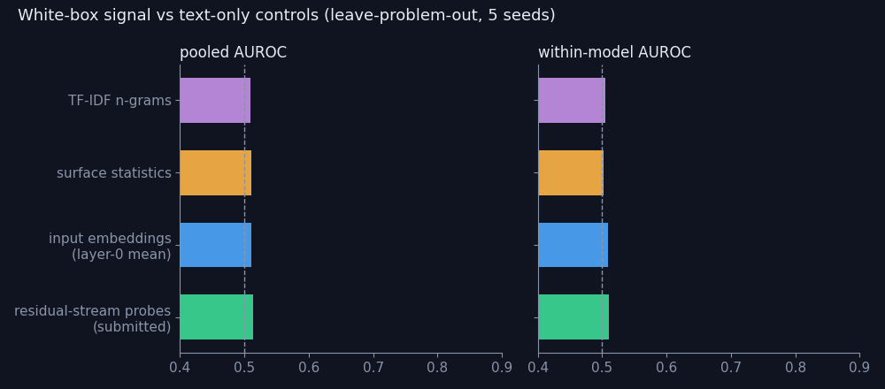
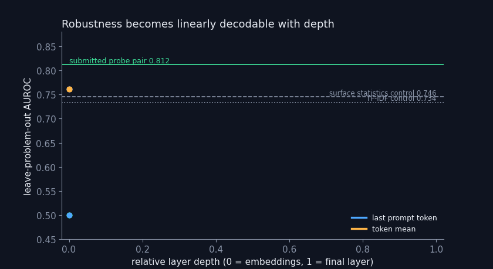
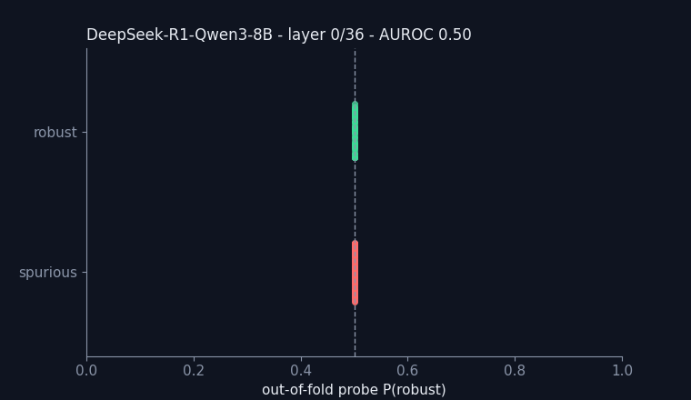
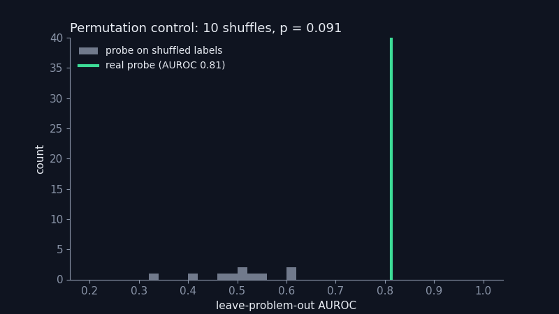
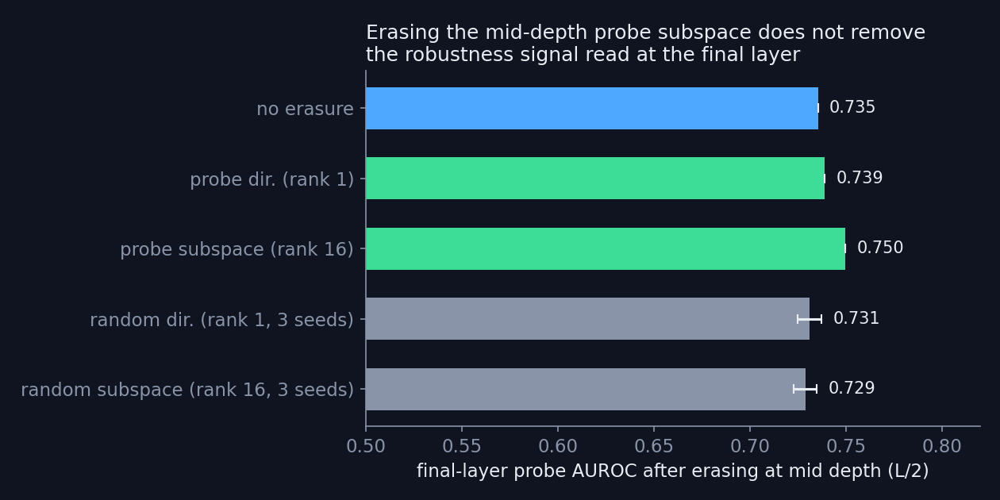

<h1 align="center">Reading Robustness Before Reasoning</h1>
<p align="center"><b>White-box residual-stream probes that predict whether a small math LLM will stay correct under meaning-preserving perturbations — from one forward pass on the prompt, before the model writes a single token.</b></p>

<p align="center">
  <a href="https://aimo-interp.github.io/">AIMO Interpretability Challenge 2026</a> · Small Models Track ·
  <a href="https://www.codabench.org/competitions/16180/">Codabench</a> · License: Apache-2.0
</p>

<p align="center"></p>

## TL;DR

For each of the four Small-Track models (Qwen3.5-4B, DeepSeek-R1-0528-Qwen3-8B, OLMo-3-7B-Think, Skywork-OR1-Math-7B) we read the model's own residual stream on the prompt and apply two small linear probes. Under leave-problem-out cross-validation the probes separate *robust* from *spurious* (model, problem) pairs far above chance and above every text-only control:

| Leave-problem-out (5 seeds × 5 grouped folds) | AUROC | Within-model AUROC | Accuracy | Balanced acc. |
|---|---:|---:|---:|---:|
| **Residual-stream probes (submitted)** | **0.812 ± 0.012** | **0.762 ± 0.038** | **0.724 ± 0.024** | **0.735 ± 0.024** |
| same, with the configuration re-selected inside every outer split (nested CV) | 0.805 ± 0.012 | 0.746 ± 0.016 | 0.720 ± 0.023 | 0.732 ± 0.023 |
| Input-embedding control (layer-0 token mean) | 0.766 ± 0.013 | 0.731 ± 0.033 | 0.676 ± 0.023 | 0.680 ± 0.022 |
| Surface-statistics control (length, `$`, `\`, words) | 0.746 ± 0.008 | 0.565 ± 0.016 | 0.688 ± 0.005 | 0.684 ± 0.006 |
| TF-IDF n-gram control | 0.734 ± 0.024 | 0.622 ± 0.037 | 0.642 ± 0.026 | 0.652 ± 0.027 |
| Same probe on shuffled labels (200 permutations) | max 0.651 | — | — | — |

Evaluation rows are labelled by the four Small-Track models themselves (95 rows over 74 problems); no problem ever appears on both sides of a split. *Within-model AUROC* averages the AUROC computed separately for each model, so it cannot be inflated by differences in base rates between models.

**Key findings**

1. **Robustness is linearly decodable before generation.** A linear readout of the evaluated model's own residual stream on the prompt predicts whether the model's accuracy will survive rename / rephrase / distract / typo / domain perturbations: AUROC 0.81, permutation p = 0.005 (the best of 200 shuffled-label refits reaches 0.651).
2. **The white-box signal beats text.** Replacing the residual stream by text-only features (same classifier, same folds) costs up to 0.20 within-model AUROC; at problem level the gain over the surface-statistics control is significant (ΔAUROC +0.052, 95 % CI [+0.002, +0.104], 175 problems).
3. **The signal is built inside the network.** At the last prompt token it is absent at layer 0, appears by 10 % depth and peaks at 40–45 % depth (AUROC 0.816).
4. **It is redundantly encoded.** Projecting the mid-depth probe direction — or its full 16-dimensional subspace — out of the residual stream *during the forward pass* does not reduce what final-layer probes can read (AUROC 0.735 → 0.739 / 0.750; random erasures 0.73). Later layers re-derive the information: a single linear bottleneck is ruled out.
5. **Fragility is shared across models.** Training each model's probe on its own labels *plus* problem-level labels measured on other models is what makes the probes work with only 9–62 own labels per model.
6. **It is cheap and deterministic.** One forward pass per problem (≈0.05–0.3 s on an RTX 3090), no sampling. The full 43-case contract test with all four models runs in ≈165 s including cold model loads; two runs give identical predictions.

## Research question

> *Is the robustness of a small reasoning model to meaning-preserving perturbations already encoded, linearly, in its internal state before it starts reasoning?*

- **Prediction (falsifiable).** If so, a linear probe on the residual stream must beat (i) surface/text-only controls, (ii) input embeddings and (iii) the same probe trained on permuted labels, under leave-problem-out validation.
- **Intervention.** If a mid-depth direction were a causal bottleneck, erasing it in the forward pass should hurt downstream decodability more than erasing random directions of the same rank (it does not — finding 4).

## Results

<p align="center"></p>

<p align="center"></p>

<p align="center"></p>

<p align="center"></p>

<p align="center"></p>

### Paired bootstrap against controls (2000 resamples over problems)

| Submitted probe minus control | own labels, 95 rows / 74 problems | problem-level labels, 700 rows / 175 problems |
|---|---|---|
| vs surface statistics, ΔAUROC | +0.086 [−0.031, +0.206] | **+0.052 [+0.002, +0.104]** |
| vs surface statistics, Δ within-model AUROC | +0.183 [−0.097, +0.504] | **+0.054 [+0.003, +0.106]** |
| vs TF-IDF, ΔAUROC | +0.081 [−0.034, +0.185] | +0.048 [−0.017, +0.111] |
| vs TF-IDF, Δ balanced accuracy | **+0.128 [+0.000, +0.249]** | +0.013 [−0.055, +0.084] |
| vs input embeddings, ΔAUROC | +0.061 [−0.035, +0.163] | +0.025 [−0.006, +0.058] |

All differences are positive; the ones whose 95 % interval excludes zero are in bold.

### Full experiment log

Every hypothesis, configuration, metric and decision — accepted and rejected — is in [`experiments/LOG.md`](experiments/LOG.md) and [`experiments/experiments.csv`](experiments/experiments.csv); raw tables (`ensembles.csv`, `layer_sweep.csv`, `nested.json`, `bootstrap_ci*.json`, `permutation_*`, `ablation_*`) are in [`experiments/`](experiments/). An independent audit of the pipeline is in [`experiments/AUDIT_verifier.md`](experiments/AUDIT_verifier.md); the one leakage issue it found (problems duplicated with CRLF vs LF line endings) was fixed and every number above is post-fix.

## Method

1. **Features (white-box).** The problem is wrapped in the evaluated model's own chat template with a fixed instruction and passed once through the model with `output_hidden_states=True` (bf16, Transformers 5.13 — the exact Codabench runtime). We keep the residual stream at the **last prompt token** and its **token mean**, at every layer.
2. **Probes.** Two linear probes per model, averaged in probability space:
   - last-token residual stream, standardised per layer and averaged over the 40–80 % depth band;
   - token-mean residual stream at the final layer.

   Each is `StandardScaler → PCA(16) → LogisticRegression(C = 0.1, class_weight = balanced)` (scikit-learn 1.8). Probability ≥ 0.5 → robust.
3. **Labels.** The official rule (robust iff the largest accuracy drop across perturbation families is ≤ 0.10, spurious iff ≥ 0.25). Recomputed from the public per-family measurements, it reproduces the official label on 156/156 rows where both exist. Problems are de-duplicated on whitespace-normalised text; one row per (problem, labelling model).
4. **Pooling labels across models.** Each model's probe is also trained on problems labelled only by *other* models (one vote per labelling model, ties dropped), always using the evaluated model's own activations. Validation uses the model's own labels only.
5. **Selection.** Eight probe configurations were compared by grouped CV; the configuration was chosen on within-model AUROC and the olympiad subset, which match the test conditions best (decision logged). The nested-CV row in the TL;DR measures the whole procedure, selection included.
6. **Submission.** Probes are exported as plain NumPy arrays (no pickles) and applied inside `are_robust(model_id, reasoning_effort, problems)`; see [`submission/`](submission/).

## Reproduce

Heavy steps ran on a Linux box with 2 × RTX 3090 (24 GB) and 15 GB RAM; the environment mirrors the official image.

```bash
AIMO_HOME=$PWD/work bash scripts/setup_env.sh   # torch 2.12.1 / transformers 5.13 / sklearn 1.8 + the four checkpoints
bash scripts/download_data.sh                   # public AIMO-Interp label sources (not redistributed)
cd src
python build_dataset.py                         # 178 problems, 363 (problem, model) label rows
PY=../work/.venv/bin/python bash ../scripts/run_extract.sh Qwen/Qwen3.5-4B deepseek-ai/DeepSeek-R1-0528-Qwen3-8B allenai/Olmo-3-7B-Think Skywork/Skywork-OR1-Math-7B
export AIMO_FEATURES=features
python analysis.py --task ensembles             # configurations and controls
python analysis.py --task nested                # selection-inclusive estimate
python analysis.py --task sweep                 # layer sweep
python analysis.py --task bootstrap --kind last:band+mean:1 [--eval-all]
python analysis.py --task perm --kind last:band+mean:1 --perms 200
python ablate.py                                # causal erasure (GPU)
python export_probe.py --kinds last:band+mean:1 --C 0.1 --out ../submission/probe_artifacts
python make_figures.py
```

Seeds are fixed everywhere (CV seeds 0–4, permutations 1000+i, bootstrap 0, random erasure directions 100–102). Feature extraction is a deterministic forward pass.

Build the Codabench bundle (Small Track):

```bash
cd submission && zip -r ../aimo-interp-small.zip solution.py aimo_features.py small.txt probe_artifacts
```

## Repository layout

```text
src/            feature extraction, dataset builder, CV and analyses, causal erasure, export, figures
scripts/        environment, extraction, CV, contract-test entry points
submission/     the exact Codabench bundle contents (solution.py + NumPy probe artifacts)
experiments/    LOG.md, experiments.csv, raw result tables, independent audit
figures/        animated figures used in this README
report/         technical report (OpenReview)
```

## Codabench submissions (Small Model Track)

| ID | Bundle | Public 14-case score |
|---|---|---|
| 1015694 | residual-stream probes (this repository, final) | accuracy 0.571, coverage 1.0, 0 invalid |
| 1015306 | earlier probe ensemble | accuracy 0.571, coverage 1.0, 0 invalid |
| 1015190 | constant "robust" contract check | accuracy 0.500 |

The public set has 14 cases (one case = 0.071), so it is used only as a contract check; the final ranking uses new, unpublished problems.

## Limitations

- Labels are scarce: 43 olympiad-level rows over 22 problems for the four models, plus 52 MATH rows for DeepSeek-R1-0528-Qwen3-8B. On the olympiad subset alone our estimates are wider (balanced accuracy 0.59 ± 0.06, AUROC 0.74 ± 0.05).
- With own labels only, the bootstrap intervals against the controls overlap zero; the advantage is significant at problem level against the surface-statistics control and smaller against input embeddings, which are themselves a strong baseline.
- The per-layer standardisation of the depth band uses statistics of all rows in a split (label-free); we measured its effect on predictions at ≤ 0.001.
- Probes are correlational; the erasure experiment shows the information is redundantly encoded, not which components use it.

## Credits

- Competition, data, baselines and runtime: the [AIMO Interpretability Challenge](https://aimo-interp.github.io/) organisers ([getting-started](https://github.com/aimo-interp/getting-started), [baselines](https://github.com/aimo-interp/baselines) under Apache-2.0, datasets on [Hugging Face](https://huggingface.co/aimo-interp)).
- Models: Qwen3.5-4B (Qwen), DeepSeek-R1-0528-Qwen3-8B (DeepSeek), OLMo-3-7B-Think (Ai2), Skywork-OR1-Math-7B (Skywork).
- Tooling: PyTorch, Hugging Face Transformers, scikit-learn, NumPy, pandas, Matplotlib.
- Author: Francisco Angulo de Lafuente ([@Agnuxo1](https://github.com/Agnuxo1)). Experiment code and analysis were written with the help of an AI coding assistant; all numbers come from logged runs in this repository.

## License

Code: Apache-2.0 (see [LICENSE](LICENSE)). Data are not redistributed; `scripts/download_data.sh` fetches them from their original sources under their own terms.
